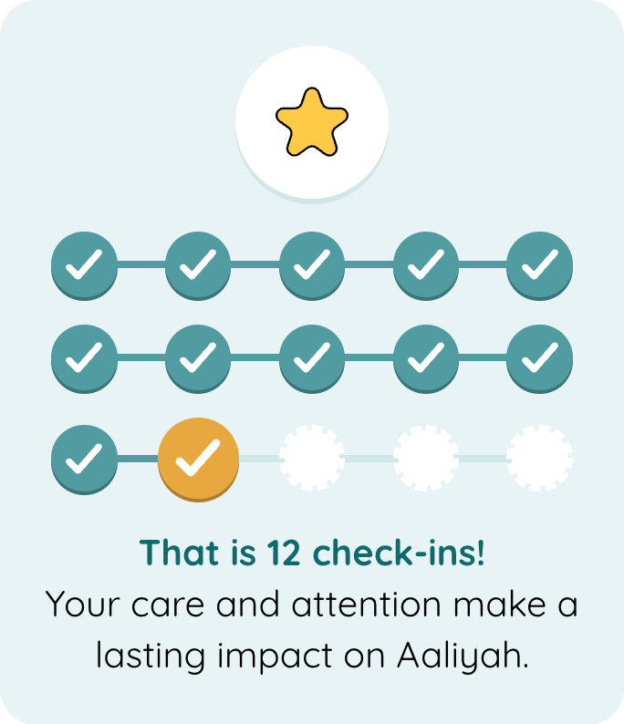

# PLH Progress Summary

Shows how many steps someone has completed, such as check-ins, as rows of ticked circles. The most recent step is highlighted, and an image, title and text can be shown with it. This component is specific to PLH deployments.

## Example

| type                 | name             | value                                     | parameter_list |
| -------------------- | ---------------- | ----------------------------------------- | -------------- |
| set_variable         | summary_title    | That is @fields.check_in_count check-ins! |                |
| set_variable         | summary_text     | Your care and attention make a lasting impact. |           |
| plh_progress_summary | check_in_summary | @fields.check_in_count                    | title: @local.summary_title; text: @local.summary_text; image_asset: images/icons/star_yellow.svg; |

[Google Sheet Demo](https://docs.google.com/spreadsheets/d/1SekXBLWGXOww-dgol3YppH5H_jMl_5HVhkKnto0LZEU)   
[Live Preview Demo](https://idems-debug.web.app/template/comp_plh_progress_summary)

## How it works

Steps are shown in rows of 5. There is always at least one empty step after the completed ones, so a new row appears as soon as the previous one is full:

| Completed (`value`) | Rows shown                                              |
| ------------------- | ------------------------------------------------------- |
| 0                   | 1 row of empty steps, nothing highlighted               |
| 4                   | 1 row: 4 ticked, 1 empty                                |
| 5                   | 2 rows: the first full, the second empty                |
| 12                  | 3 rows: 10 ticked in the first two, then 2 ticked and 3 empty |

The most recent step is larger and in the highlight colour. It animates in each time the component is shown, including when returning to the page, and whenever the count changes. Once it has appeared, the image bounces and a ring and sparks spread out from it, if at least one step is completed. Animations are turned off when the device is set to reduce motion.

!!! note "Text is plain and is not translated"

    `title` and `text` are shown as plain text, so markdown is not supported.

    Text written directly in `parameter_list` is not translated. To translate it, put the text in the `value` of a `set_variable` row and pass it in with `@local`, as in the example above.

## Parameters

| Parameter      | Value           | Description |
| -------------- | --------------- | ----------- |
| value (column) | number          | The number of completed steps. Numbers stored as text (e.g. field values) work; anything else counts as 0. At most 50 steps are shown. |
| title          | "" (default)    | No title |
| title          | string          | Bold text shown under the steps |
| text           | "" (default)    | No text |
| text           | string          | Text shown under the title |
| image_asset    | "" (default)    | No image |
| image_asset    | string          | Path to an image asset, shown in a white circle above the steps |

## Theming

Themes can change the colours by setting these variables in their variable overrides:

| Variable                             | Default                      | Used for |
| ------------------------------------ | ---------------------------- | -------- |
| `progress-summary-background`        | `var(--ion-color-primary-50)`  | Card background |
| `progress-summary-track-color`       | `var(--ion-color-primary-100)` | Lines after the most recent step, and the edge under the image circle |
| `progress-summary-completed-color`   | `var(--ion-color-primary-500)` | Completed steps, the lines between them, and half of the sparks |
| `progress-summary-current-color`     | `var(--ion-color-secondary-500)` | The most recent step, the ring and the other sparks |
| `progress-summary-title-color`       | `var(--ion-color-primary-600)` | Title |
